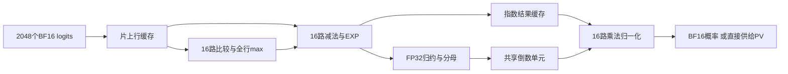

# 数字 Softmax 的具体架构与 2048 长度基线

2026-10-16。本文补充此前 Ising 报告中数字基线不足的问题。三种证据严格分开：**公开论文的布局后结果、由这些结果换算的 2048 长度估计、本次实际运行的软件数值检查**。没有声称本机完成了 RTL 综合、功耗测量或 Qwen PPL 评测。

结论：数字 softmax 不需要 2048 个 exp/除法器。一个明确的 BF16 公开参照是 VEXP：单核运行整个 softmax 的平均吞吐约 0.45G 输出/s、功耗 7.1mW，据此线性换算 2048 元素约 **4.55µs、32.3nJ/行**。这是数字方案可用的有出处估计；之前的 32.768nJ 是未校准 TLM 算术代理，两者接近不构成对旧系数的验证。

## 1. “标准”首先是计算语义，不是一套固定电路

稳定 softmax 对一行 logits 执行：

\[
m=\max_i x_i,\quad e_i=\exp(x_i-m),\quad s=\sum_i e_i,
\quad r=1/s,\quad p_i=e_i r.
\]

减去最大值不改变实数 softmax，只是避免指数溢出。关键点：**每个输入算一次 exp、每行只求一次倒数、最后每项乘该倒数**，而非给每项配置一个除法器。

| 操作 | M=2048 的次数 |
|---|---:|
| 求最大值的比较 | 2047 |
| 减去最大值 | 2048 |
| 指数计算 | 2048 |
| 求和加法 | 2047 |
| 倒数 | 1 |
| 归一化乘法 | 2048 |

这些是数学操作总数，不等于资源实例数或时钟数。FP16/BF16 是输入/输出格式；中间最大值、指数、累加的格式可以不同。对本项目推荐的保守数字基线应保留原 softmax 语义，使用近似 EXP 硬件、足够精度的累加和一次倒数，再转回 BF16。不能直接把需要重训练的 INT8/ConSmax 称为 Qwen BF16 的相同精度基线。

## 2. GPU、数字 ASIC 实际怎样做

### 2.1 GPU 的 fused softmax

适合片上存储的行先加载到寄存器/SRAM，再在片上完成 max、exp、sum、normalize，最后一次写出。并不是每个公式步骤都单独读写 DRAM。Triton 官方示例给出了完整实现，也明确指出快速 exp 是近似实现。[官方 fused-softmax 示例](https://triton-lang.org/main/getting-started/tutorials/02-fused-softmax.html)

单行 2048 个 BF16 输入仅 4KiB，BF16 输出也为 4KiB。独立算子的输入/输出接口数据量可以是 8KiB；片内操作仍需寄存器访问、归约通信等。不能将一次外部读写解释为所有内部访问消失，也不能将许多行大批量吞吐除成单行延迟。

### 2.2 attention 中的 online softmax

FlashAttention 一类融合实现进一步不要求把完整概率行写到 DRAM，而是随 QK 分块处理，同时维护当前最大值 m、分母 l 和未归一化输出向量 o。设新块的最大值为 m_b：

\[
m'=\max(m,m_b),\quad a=\exp(m-m'),\quad
l'=al+\sum_{i\in block}\exp(x_i-m'),
\]
\[
o'=ao+\sum_{i\in block}\exp(x_i-m')V_i,\quad Y=o/l.
\]

它在实数计算上保持原 attention，不依靠随机采样；有限精度结果会受运算顺序影响。块重缩放有额外操作，但能避免物化大的中间矩阵。[FlashAttention-2 第 2.3、3.1 节](https://arxiv.org/html/2307.08691v1)

因此评价 Ising 完整 attention 时，必须纳入 fused/online 数字基线；不能先让数字方案反复写全量 score/probability 到 DRAM，再把避免这些访问全部算成 p-bit 独有收益。

### 2.3 数字 ASIC 的 EXP/倒数

常见实现包括指数范围规约后的小 LUT/分段多项式、近似基数 2 的指数及整数移位。倒数用查表加修正、迭代或共享除法器。没有统一规定必须采用哪种单元。

恒等变换 `exp(x)=2^(x*log2(e))` 本身不改变函数；保留缩放系数时可以作为原 exp 的硬件实现。若直接将 `exp(x)` 换成 `2^x`，则改变了 attention 温度，需要质量验证，不能与原函数混为一谈。

Softermax 组合了基数变化、低位宽和在线归一化，其 BERT 结果包含量化微调；它是一个很强的算法/硬件协同设计参照，但不自动等价于无需训练替换 Qwen BF16。[Softermax 第 III、V 节](https://arxiv.org/pdf/2103.09301)

## 3. 可审阅的共享流水线结构

可以设置 P=16 个处理 lane，处理长度 M=2048 的行：

这是拟议的常规结构图，不是已完成 RTL。各阶段可共享部分算术资源，或通过多行双缓冲重叠，取决于面积/吞吐目标。

| 资源 | 说明性配置 |
|---|---|
| 比较/减法/EXP/归一化 | 各阶段最多 16 路；不为 2048 个位置各配一套 |
| sum | FP32 加法归约树和分段累加器；需验证累加反馈延迟及启动间隔 |
| reciprocal | 每行调用一次的共享单元 |
| 行缓存 | BF16 输入 4KiB；若保留 FP32 指数，另需 8KiB |
| 输出 | 4KiB BF16；融合 PV 时可不物化完整输出 |
| 控制 | 阶段状态机、行计数、双缓冲/流水线握手 |

若用三遍处理并假设每遍可持续 P 项/周期，固定流水开销暂设 16 cycles：

\[
C_{row}=3\lceil2048/P\rceil+16.
\]

| 并行 lane | 假设周期/行 | 500MHz 时的假设延迟 |
|---:|---:|---:|
| 1 | 6160 | 12.32µs |
| 4 | 1552 | 3.104µs |
| 16 | 400 | 0.800µs |
| 64 | 112 | 0.224µs |

**这一表是明确的调度假设，尚未证明 RTL 能达到所设时钟和启动间隔，也没有据此捏造功耗/面积。** 16 lane、100MHz 对应 4.0µs，1GHz 对应 0.4µs。增大并行度会增加 EXP、缓存端口、归约和布线面积，不能认为能量必然不变。

## 4. 有具体硬件依据的 BF16 基线：VEXP

VEXP 在 RISC-V Snitch 的 FPU 中增加 BF16 EXP 单元。每核 4 路 BF16 SIMD、EXP 指令延迟 2 cycles；最大值、求和和归一化仍然由处理器/FPU 执行，并把倒数移出逐元素循环。其优化 softmax 给出 2.125 cycles/output 的核内计算分析，硬件评估另报告整个 softmax 的平均吞吐。[原文 IV-B/C、V-B/C 与表 IV](https://arxiv.org/html/2504.11227v1)

| 项目 | 论文报告/本次推算 | 范围 |
|---|---:|---|
| 工艺、电压、频率 | GF 12nm、0.8V、1GHz | TT 条件 |
| 平均 softmax 吞吐 | 0.45G 输出/s/核 | 整个 softmax，不是 EXP 峰值 |
| 平均功耗 | 7.1mW/核 | 整个 core 执行 softmax 期间 |
| 2048 行延迟 | **4.55µs** | 2048/(0.45×10^9) 的线性换算 |
| 2048 行 core 能量 | **32.3nJ** | 7.1mW×4.55µs |
| 新增 EXP 单元面积 | 968µm²=0.000968mm²/核 | 仅新增 EXP，不含完整 core/缓存 |
| 单独 EXP 能量 | 6.39pJ/输出 | 独立 EXP kernel 的电路评估 |
| 2048 次 EXP 对应能量 | 13.09nJ | 不代表完整 softmax |

论文使用布局布线、寄生参数注释门级仿真与 PrimeTime。**这是布局后评估，不是芯片实测；4.55µs/32.3nJ 是由论文平均指标换算，不是本次新跑出的 2048 行硬件数据。** 共享 SRAM、cluster 互连及外部存储没有作为完整系统预算包括在这组 per-core 数字中；真实行长、软件启动、访存和工作负载可能改变外推值。

与前一次仅有“每个非线性 10pJ”的估算相比，这个参照明确给出了精度、工艺、时钟、吞吐、功耗及评估范围。它仍不能代替本项目同工艺综合。

数字面积的另一个参照是 ITA：22nm 设计中 softmax 约 0.00571mm²、0.847mW，但它是量化整数架构和不同负载下的模块。它有完整模块面积，VEXP 有更接近本项目 BF16 的软硬件语义，二者不能拼接成同一套数字电路的 PPA。[ITA](https://arxiv.org/html/2307.03493v2)

## 5. 本次实际执行的数值检查

脚本 `evaluate.py` 使用标准库实现了一个确定性数字近似原型：

- 所有输入先舍入为 BF16；最大值保持稳定 softmax 语义。
- exp 在 [-16,0] 上以 1/16 间隔存 257 个无符号 Q1.24 系数，10bit 位置插值；更小项截为 0。
- 16 路 FP32 累加后树形归约、FP32 倒数/乘法，最终输出 BF16。
- 与同一 BF16 输入上的 FP64 稳定 softmax 比较，另记录直接将参考输出舍入到 BF16 的差异。

为精确表达 exp(0)=1，系数需要 25bit；257×25bit 紧密存储为 804B，若逐项用 32bit 字则为 1028B。这是唯一系数内容量，不是整个 16 lane 电路面积；16 路并行查表需要 ROM 复制、多端口逻辑或银行，插值还需要额外运算和访问。没有将该原型的软件结果当作 VEXP RTL 的复现，也没有把 VEXP 的能耗套到本原型上。

实际完成 **3 个种子、8 类分布、192 行、每行 2048 个元素**。包括均匀、高斯、宽分布、单峰、近似并列、大偏置、mask 及截断边界；它们是合成压力输入，不是从 Qwen 采集的 logits。

| 本次实际数值结果 | 数值 |
|---|---:|
| 平均每行 half-L1，与 FP64 参考比较 | 4.752×10^-4 |
| 最差每行 half-L1 | 1.240×10^-3 |
| 最差单个概率绝对误差 | 1.621×10^-3 |
| 最差输出行和偏差 | 2.132×10^-3 |
| 相对“参考直接舍入 BF16”的最差概率差 | 9.766×10^-4 |

所有输出有限且非负、mask 位置为 0，均匀分布输出精确匹配；行和通过预先设定的 0.005 容差检查。half-L1 不称为 TV，因为 BF16 输出不一定严格归一化。这些结果包含 BF16 输出舍入误差，不能直接解释成 LUT 误差，也不能据此声称 Qwen PPL 已经不变。

这个检查的作用是把“共享 LUT/插值/归约/倒数”落成可执行数值路径，证明它无需随机采样和重训练即可计算原 softmax 的近似；具体 Qwen 精度及 RTL PPA 还需单独验证。

## 6. 与现有 Ising 数值重新对齐

保持 M=2048、S=512，仍使用之前假设的 CTMC 映射 `t=2064τ`。下面每个 Ising 行仅包含 2047 个单元的核心持续功耗，没有配置、反馈和编码。

| 方案 | 活动功耗 | 每行时间 | 每行能量 | 证据性质 |
|---|---:|---:|---:|---|
| VEXP 数字 BF16 softmax | 7.1mW/core | 4.55µs | 32.3nJ | 论文布局后指标的长度换算 |
| Ising：4.9µW/位、τ=1ns | 10.0mW | 2.064µs | 20.7nJ | 假设情景，仅核心 |
| Ising：4.9µW/位、τ=10ns | 10.0mW | 20.64µs | 207nJ | 假设情景，仅核心 |
| Ising：10µW/位、τ=1ns | 20.5mW | 2.064µs | 42.3nJ | 假设情景，仅核心 |

这不是同节点、同输出契约的公平硬件胜负表：数字输出概率，Ising 输出 512 个相关性待验证的索引。它只显示门槛量级。**有利情景下 Ising 核心剩下的能量余量约 32.3−20.7=11.6nJ；配置/反馈/读出若超过这部分，单独替代 softmax 的能量优势就消失。** 若 τ=10ns，核心已经比该数字参照多约 6.4 倍能量。

以 32.3nJ 数字 core 预算、不计外围时，Ising 单元上限约为 τ=1ns 时 7.65µW、τ=10ns 时 0.765µW。偏置 16bit×2047、16Gb/s 的理想配置另需 2.047µs，仍应检验是否可重叠。0.8µs 的 16 lane/500MHz 只是拟议专用数字调度；不能以它配上 VEXP 7.1mW，伪造更低的数字能量。

完整 attention 仍需比较 online softmax＋dense PV、数字类别采样器＋相同 sparse PV、原生 Ising＋相同 sparse PV；前两种数字基线各自的归约、存储和采样建表成本都要计入。Qwen 的 GQA 复用仍按前一报告处理。

## 7. 可以交付的判断与待完成项

目前数字基线已有：稳定 softmax 的具体资源和操作计数；公开 BF16 设计的功耗/吞吐、由其推算的 2048 长度时间/能量；明确标为假设的 lane/频率调度扫描；本次实际运行的数值原型与原始指标。

仍不能交付的是本项目芯片的完整 mm²、峰值/平均 mW 和 signoff 时钟，因为没有选定 PDK、存储宏、EXP/reciprocal RTL 和最终数据流，尚未综合。后续应先落定 BF16＋FP32 归约的确定性 RTL，然后在同一工艺、时钟约束和真实 Qwen logits 下与 p-bit 外围一起评估；不再以泛化的 nonlinear/op 常数替代数字硬件结果。

运行：`python -X utf8 evaluate.py`。数值原始数据见 `numerical_rows.csv`，分组见 `numerical_summary.csv`，调度见 `schedule.csv`，来源与哈希见 `source_manifest.json`。公开来源在 Zotero 新增 4 篇、复用 ITA 1 篇，并核验托管 PDF；不上传论文全文到 GitHub。
